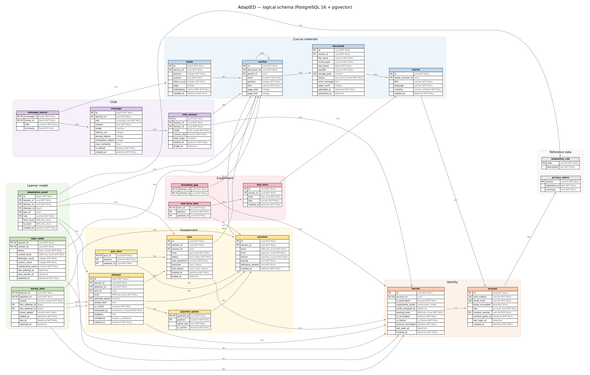

# AdaptED — Database documentation

Criterion: **Database — transactional (OLTP), PostgreSQL 16 + pgvector.**
Basis: Business Analysis (US-03 … US-21, NFR-05, NFR-12), Technical specification section 7, decisions [0001](../../doc/decisions/0001-knowledge-check-rules.md) and [0002](../../doc/decisions/0002-confidence-and-revision.md) (confidence, review list, topic/revision quizzes, preferences, simulated profiles — extension beyond the BA).

| Artefact | File |
| --- | --- |
| Data dictionary (tables, columns, types, keys, data-quality rules) | [data-dictionary.md](data-dictionary.md) |
| Logical schema, colour-coded by block | [er-diagram.svg](er-diagram.svg) / [er-diagram.png](er-diagram.png) |
| DDL script (generated from the migrations) | [../db/schema.sql](../db/schema.sql) |
| Migrations (the only way the schema is created or changed) | `backend/alembic/versions/0001…0006` |
| Roles and databases (first start of the container) | `db/init/01-roles-and-databases.sh` |
| Reference data | `backend/app/db/sql/reference_data.sql`, `python -m scripts.seed_reference` |
| Demo / test data with edge cases | `python -m scripts.seed_demo` |
| Integration tests (real PostgreSQL) | `backend/tests/` — 109 tests |

---

## 1. Why PostgreSQL

The data is strongly relational (account → learner → topic states → answers → questions → sections → documents → courses) and every learning action must be **atomic**: an answer, the update of the learner model and the adaptation decisions are saved together or not at all. PostgreSQL gives ACID transactions, rich constraints, triggers and PL/pgSQL, and with the **pgvector** extension it also stores the embeddings and searches them (HNSW index). One DBMS is enough: a separate vector database or an OLAP engine (ClickHouse) is **not justified** at the scale of a diploma experiment (tens of users, ~800 chunks per corpus); the analytics needs are covered by views in a separate schema (section 8).

Data layers (raw → staging → mart) are also **not needed**: there is no external data loading. The only "layer" is the separation between the transactional schema `public` and the read-only, pseudonymised schema `analytics`.

## 2. Logical schema



22 tables in 7 blocks (colours in the diagram):

| Block | Tables | Purpose |
| --- | --- | --- |
| Reference data (grey) | privacy_notice, adaptation_rule | Fixed data filled by script |
| Identity (orange) | account, learner | Account with encrypted e-mail; pseudonymous learner with preferences (theme, revision reminders); simulated learners without account |
| Course materials (blue) | course, document, section, chunk | Uploaded files, topics, chunks with embeddings |
| Assessment (yellow) | question, question_option, quiz, quiz_item, attempt | Questions, knowledge checks, reviews, topic quizzes, revision quizzes, tests, answers with confidence |
| Learner model (green) | topic_state, adaptation_event, review_item | Status/level per topic; log of every decision; review list of questions |
| Chat (purple) | chat_session, message, message_source | Chats, guided lessons, sources of answers |
| Experiment (pink) | test_form, test_form_item, simulated_gap | Fixed pre-/post-tests for modes A and B; ground-truth gaps of simulated learners (KPI K2) |

**Relationship types:** 1:1 (account–learner; optional on the learner side since 0006 — a simulated learner has no account), 1:N (course–document, document–section, …), N:M (quiz–question through quiz_item, test_form–question through test_form_item, message–chunk through message_source), self-reference (section.parent_id — heading tree).

## 3. Normalisation (3NF)

* **1NF** — atomic values, no repeating groups (options of a question are rows of `question_option`, not an array).
* **2NF** — tables with composite keys (`question_option`, `quiz_item`, `topic_state`, `message_source`, `test_form_item`, `review_item`, `simulated_gap`) have only attributes that depend on the whole key.
* **3NF** — no transitive dependencies: e.g. the topic of a question is not stored in `attempt` (it is derived through `question → section`), the owner of a document is not stored in `document` (it comes from `course`).

**Documented denormalisation:** `topic_state.attempts_count / correct_count / consecutive_errors` repeat information that can be computed from `attempt`. They are needed on every answer by the adaptation rules, so they are maintained by the trigger `trg_attempt_apply` **in the same transaction** as the answer and protected by `CHECK (correct_count <= attempts_count)`. `message.max_similarity` repeats the best `message_source.similarity` for the K1 analysis. `review_item.reason / times_added / due_at / resolved_at` summarise the learner's answers to one question; they are read every time a review, topic quiz or revision quiz is composed, so the trigger `trg_attempt_review_list` maintains them in the same transaction as the answer.

**No JSON documents** are stored: every attribute has its own typed column.

## 4. Data types

UUID (random, `gen_random_uuid()`) for entities visible through the API, `bigint identity` for high-volume rows (chunk, attempt, message, adaptation_event); `timestamptz` for all times; `numeric` comparison for the 75 % rule; PostgreSQL ENUM types for closed lists of values (18 types, e.g. `difficulty_level`, `topic_status`, `check_end_reason`, `answer_confidence`, `review_reason`, `ui_theme`); `vector(384)` for embeddings; `bytea` for the encrypted e-mail. Money is not stored by the application.

## 5. Integrity

| Mechanism | Examples |
| --- | --- |
| Primary keys | every table (test `test_every_table_has_a_primary_key`) |
| Foreign keys with explicit delete rules | CASCADE from account → learner → all learning data (US-03); RESTRICT for reference data; SET NULL for `review_item.first/last_attempt_id` (provenance only: deleting one quiz must not remove a question from the review list); every FK is indexed (test) |
| NOT NULL / UNIQUE | e-mail hash, auth subject, file hash per course, one open check per learner and topic (partial unique index), one review item per learner and question (PK) |
| CHECK | file size ≤ 50 MB and allowed MIME types; `failed` document has an error message; `ready` document has a storage path; level-1 sections have no parent; one answer form per attempt; user question ≤ 1 000 chars; experiment mode only for participants; consent not in the future; a learner has an account **exactly when** it is not simulated; a check has ≤ 6 questions, a topic quiz has a topic, a revision quiz 10–20 questions, every quiz 1–30; review item due/resolved after it was added |
| Triggers (cross-table rules) | exactly one correct option for a multiple-choice question (deferred constraint trigger); an answer must belong to an open quiz of the same learner and be within the question limit; answers are immutable; confidence required in check/review/topic/revision quizzes and NULL in pre-/post-tests; topic/revision quizzes multiple-choice only and not for mode A; ground-truth gaps only for simulated learners and topics |

### Transactions

* The application connects through one session per request: **commit on success, rollback on any error** (`app/db/session.py`).
* Each use case is one transaction. Example — answering a check question: `INSERT attempt` → trigger updates `topic_state`, writes `adaptation_event`, may close the `quiz`. If any step fails, nothing is saved (test `test_answer_and_learner_model_are_one_transaction`).
* Concurrency: `start_check`, `stop_check` and the attempt trigger lock the quiz row (`SELECT … FOR UPDATE`), so two parallel answers cannot exceed the limit or close a check twice.
* Migrations: every `alembic upgrade` / `downgrade` runs in **one** transaction (transactional DDL). A downgrade that would destroy referenced reference data fails and leaves the database unchanged.

## 6. Business logic in the database

### 6.1 Functions

| Function | Rule |
| --- | --- |
| `topic_status_from_answers(total, correct, last_two_correct_high)` | **US-11**: < 2 answers → not_checked; ≥ 75 % correct **or** last two answers correct at Intermediate/Advanced → mastered; otherwise gap |
| `next_level(level, correct)` | **US-12**: correct → one level up (max Advanced); incorrect → one level down (min Basic) |
| `topic_of(section)` | Level-1 ancestor (topic) of any section (recursive CTE) |
| `start_check(learner, topic)` / `stop_check(quiz)` | Open (or resume) and close a knowledge check |
| `check_summary(quiz)`, `finish_check(quiz, reason)` | Counters of a check; closing it with outcome |
| `mask_email(text)` | `diana@example.com` → `d***@example.com` |
| `quiz_review(quiz)` | **Decision 0002, rule 4**: answers of a quiz that were incorrect or `not_sure` / `guessing`, with the chosen answer, the correct option (or reference answer), feedback and confidence |
| `revision_offer(learner, course, absence_days = 7)` | **Decision 0002, rule 6**: `(offered, reason)` with reason `absence` / `new_topic` / NULL; respects `revision_reminders` and mode A. The backend passes `REVISION_ABSENCE_DAYS` |
| `analytics.refresh_summaries()` | Refresh of the materialized summary |

### 6.2 Topic knowledge check

A knowledge check is a `quiz` with `kind = 'check'`:

| Condition | What the database does |
| --- | --- |
| Start | first question is always **Intermediate** (`start_check` sets the level) |
| Correct answer | next question one level harder (`level_up`) |
| Incorrect answer | the error is explained (feedback), next question one level easier (`level_down`) |
| **Two correct Advanced answers in a row** (i.e. after a correct Intermediate) | check ends: `success_sequence` |
| **Two incorrect answers in a row** | check ends: `two_consecutive_errors`; basic chapter linked (`basic_chapter_link`) |
| **6 questions answered** | check ends: `question_limit` |
| Learner presses "Stop" | `stop_check`: `stopped_by_learner` |

**Outcome of the check = the US-11 rule applied to the answers of this check.** This keeps the new rules consistent with the BA:
success sequence → always Mastered; two errors in a row → always Gap (with ≤ 6 answers the rate cannot reach 75 % when the last two are wrong); limit or stop → US-11 decides (e.g. 4/6 with the last two correct at Intermediate/Advanced → Mastered; 4/6 otherwise → Gap); fewer than 2 answers → Not checked. The outcome is copied to `topic_state.status`; a Gap schedules a review after one day (US-20).

**Experiment mode A (plain RAG):** answers are stored and the outcome is calculated for the analysis, but the level stays Intermediate and the check is not ended early — the learner model does not influence the tutor (US-12, US-15).
**Pre- and post-tests** never change the learner model.

### 6.3 Confidence, review list, topic and revision quizzes (decision 0002)

An extension beyond the BA ([decision 0002](../../doc/decisions/0002-confidence-and-revision.md)); nothing of 6.2 changes.

| Rule | What the database does |
| --- | --- |
| Confidence after every answer in check, review, topic quiz, revision quiz | `attempt.confidence` (`sure` / `not_sure` / `guessing`) required by `trg_attempt_validate`; must be NULL in pre-/post-tests |
| Immediate feedback when incorrect or not sure | stored in `attempt.feedback`; returned by the API (not in this layer) |
| Review list | `trg_attempt_review_list`: incorrect → item with reason `incorrect`; correct but `not_sure`/`guessing` → reason `unsure`; due after 1 day; a later correct answer with `sure` sets `resolved_at`; a new mistake reopens it (`times_added` + 1) |
| End-of-quiz review | `quiz_review(quiz)` |
| Topic quiz (`kind = 'topic_quiz'`) | one topic (`section_id` required), ≤ 30 questions (backend default 15), multiple choice only; **no change** of `topic_state` (status, level, counters) and no adaptation events; completed automatically at `max_questions` |
| Revision quiz (`kind = 'revision'`) | 10–20 questions, multiple choice only, no change of `topic_state`, completed automatically; offered by `revision_offer()` |
| Experiment fairness | confidence stored in both modes; review list, topic and revision quizzes not for mode A (`trg_quiz_adaptive_only`, `trg_attempt_review_list`); pre-/post-tests never touch the review list |
| Simulated profiles (US-18, KPI K2) | `learner.is_simulated`, no account; ground truth in `simulated_gap`; compared in `analytics.v_gap_detection`; excluded from `mv_check_summary` |

### 6.4 Triggers

| Trigger | Table | Purpose |
| --- | --- | --- |
| `trg_attempt_validate` (BEFORE INSERT) | attempt | quiz open, same learner, question in the quiz, limit not reached; multiple choice only in topic/revision quizzes; confidence rules |
| `trg_attempt_apply` (AFTER INSERT) | attempt | counters of `topic_state`, adaptation, ending the check; topic/revision quizzes: no learner-model change, auto-complete at the limit |
| `trg_attempt_review_list` (AFTER INSERT) | attempt | maintains `review_item` (not for mode A, never for tests); fires after `trg_attempt_apply` (name order) |
| `trg_attempt_immutable` (BEFORE UPDATE) | attempt | answers cannot be edited (audit trail for the experiment) |
| `trg_quiz_adaptive_only` (BEFORE INSERT / UPDATE OF kind, learner_id) | quiz | no topic or revision quiz for mode A participants |
| `trg_simulated_gap_validate` (BEFORE INSERT / UPDATE) | simulated_gap | only simulated learners and level-1 sections |
| `trg_question_has_correct`, `trg_option_keeps_correct` (deferred) | question, question_option | a multiple-choice question always has a correct option |
| `trg_topic_state_touch` | topic_state | maintains `updated_at` |

## 7. Roles, access rights and personal data

| Role | Type | Rights |
| --- | --- | --- |
| `admin` | group, NOLOGIN | owns the schema and all objects; runs migrations (DDL) |
| `app_read` | group, NOLOGIN | SELECT on application tables, EXECUTE on read-only functions |
| `app_write` | group, NOLOGIN, member of app_read | + INSERT/UPDATE/DELETE, EXECUTE on check functions, `quiz_review`, `revision_offer`; **cannot** change reference data or the schema |
| `analytics_read` | group, NOLOGIN | only the pseudonymised views in schema `analytics` |
| `adapted_migrator` | login | member of `admin` (migrations `SET ROLE admin`) |
| `adapted_app` | login | member of `app_write` — **the application never runs as a superuser** (test) |
| `adapted_analyst` | login | member of `analytics_read` |

* **New objects:** `ALTER DEFAULT PRIVILEGES FOR ROLE admin …` grants the rights automatically to every table, sequence and view created later by a migration (test `test_new_tables_get_rights_automatically`). EXECUTE on functions is revoked from PUBLIC and granted function by function.
* **Passwords:** AdaptED stores **no passwords**. Sign-up and login are handled by Supabase Auth, which keeps only bcrypt hashes; the database stores the identity-provider subject. Database login roles use SCRAM-SHA-256 (PostgreSQL 16 default). No MD5 / SHA-1 anywhere.
* **Personal data:** only `account` contains personal data. The e-mail is stored **encrypted** (Fernet, key outside the database) and as an **HMAC-SHA256 hash** with a secret pepper for look-ups. All learning data refers to the pseudonymous `learner.id`. Simulated learners have no account at all. Preferences (`ui_theme`, `revision_reminders`) and `last_seen_at` are stored on the pseudonymous learner, not in `account`.
* **Masking / anonymisation:** view `account_masked` (admin screens) shows a shortened hash instead of the e-mail; `mask_email()` / `app.core.crypto.mask_email()` mask addresses for logs and screens; schema `analytics` contains only pseudonymous ids and no personal columns (test `test_views_expose_no_personal_data`).
* **Deletion (GDPR, US-03):** deleting an account cascades to the learner, own courses, documents, quizzes, answers, topic states, review items, chats (test).
* **New objects of 0006:** `review_item` and `simulated_gap` get app rights from the default privileges; `analytics_read` cannot read them (test `test_analyst_reads_new_views_but_not_new_tables`); `quiz_review` and `revision_offer` are executable only by the application roles (test `test_new_functions_are_granted_only_to_the_application`).

## 8. Views

| View | Purpose |
| --- | --- |
| `analytics.v_attempt` | every answer with mode, topic, level, **confidence** — pseudonymised |
| `analytics.v_topic_state` | learner model per topic with correct rate |
| `analytics.v_check_session` | knowledge checks: outcome, end reason, questions, correct answers (KPI K2) |
| `analytics.v_answer_quality` | latency, tokens, similarity, refusals, number of sources (KPI K1, NFR-01/02) |
| `analytics.v_test_result` | pre-/post-test scores per mode (KPI K3) |
| `analytics.v_confidence_calibration` | per mode, level and confidence: answers, correct answers, correct rate (real learners only) |
| `analytics.v_gap_detection` | simulated learners: every topic of their courses with predicted status, predicted/actual gap and `result` TP / FP / FN / TN (KPI K2) |
| `analytics.mv_check_summary` (materialized) | checks, mastered and gaps per experiment mode, **real learners only**; `analytics.refresh_summaries()` |
| `account_masked` | admin view of accounts without readable personal data |

Every analytics view where learners appear has the column `is_simulated`, so simulated profiles can be filtered out of real-participant results.

KPI K2 from `v_gap_detection`:

```sql
SELECT round((count(*) FILTER (WHERE result IN ('TP', 'TN')))::numeric / count(*), 3) AS accuracy,
       round(2.0 * count(*) FILTER (WHERE result = 'TP')
             / NULLIF(2 * count(*) FILTER (WHERE result = 'TP') + count(*) FILTER (WHERE result IN ('FP', 'FN')), 0), 3) AS f1_gap
  FROM analytics.v_gap_detection;
```

## 9. Indexes

| Index | Why |
| --- | --- |
| `ix_chunk_embedding_hnsw` (HNSW, `vector_cosine_ops`) | semantic search of the 5 nearest chunks for every question (UC-1); HNSW gives fast approximate search without training, unlike IVFFlat |
| `ix_chunk_content_fts` (GIN, `to_tsvector`) | keyword search / hybrid retrieval |
| Every foreign key has an index (test) | fast joins and cascading deletes (US-03) |
| `ix_attempt_learner_created`, `ix_quiz_learner_started`, `ix_chat_session_learner_started`, `ix_message_session_id` | history of a learner / chat in time order |
| `ix_question_section_level` | choosing the next question of a topic at a given level |
| `ix_topic_state_learner_gaps` (partial `status = 'gap'`) | recommended topic and review sessions read only gaps (US-13, US-20) |
| `ix_topic_state_due_reviews` (partial) | reviews that are due |
| `uq_quiz_one_open_check` (partial unique) | at most one open check per learner and topic |
| `uq_question_option_one_correct` (partial unique) | at most one correct option |
| `uq_attempt_quiz_question` (partial unique) | one answer per question in a quiz |
| `ix_review_item_open_due` (partial `resolved_at IS NULL`, on `learner_id, due_at`) | composing a review, topic quiz or revision quiz reads only the open, due items of one learner; resolved items (the majority over time) stay out of the index |

## 10. Schema versioning

* The schema is created **only** by Alembic migrations (`backend/alembic/versions`), stored in Git together with the code; the table `alembic_version` records the applied revision.
* Each migration has an `upgrade()` and a `downgrade()` and runs in one transaction. Tests rebuild the test database from zero (`downgrade base` → `upgrade head`) on every run.
* `db/schema.sql` is **generated** from the migrated database by `db/export_schema.sh` and is never edited by hand.
* A change of the schema = a new migration file + regenerated `schema.sql`, `data-dictionary.md`, `er-diagram.*` in the same commit.

| Revision | Content |
| --- | --- |
| 0001 | 20 tables, ENUM types, keys, constraints, indexes |
| 0002 | roles `app_read`, `app_write`, `analytics_read`, default privileges, schema `analytics` |
| 0003 | functions and triggers (learner model, knowledge check, integrity, masking) |
| 0004 | reference data |
| 0005 | analytics views, materialized summary, `account_masked` |
| 0006 | decision 0002: `attempt.confidence`, `review_item`, `simulated_gap`, learner preferences / `is_simulated` / `last_seen_at`, quiz kinds `topic_quiz` and `revision`, extended attempt triggers, `quiz_review()`, `revision_offer()`, analytics `v_confidence_calibration`, `v_gap_detection`, `is_simulated` in the views. `quiz_kind` is **recreated** (not `ALTER TYPE … ADD VALUE`): the upgrade runs in one transaction and a value added by `ADD VALUE` cannot be used before commit; recreation also allows a real downgrade. The downgrade refuses (and changes nothing) while topic/revision quizzes or simulated learners exist (test `test_downgrade_refuses_to_drop_simulated_learners`) |

## 11. Test data

* **Reference data** (`reference_data.sql`, idempotent): Privacy Notice versions, 6 adaptation rules.
* **Demo data** (`seed_demo.py`, runs as the application role, idempotent): 6 accounts (admin, ordinary student, participants in mode A, mode B and before mode assignment, a student with private courses); the shared evaluation corpus with 4 topics, 11 subsections, 33 chunks; 82 questions; documents in every status (ready / processing / failed without text layer); a private course without documents; knowledge checks ending in **every** way (success sequence, two errors, limit in mode A and B, stopped after one answer, still in progress); a review session; pre-/post-tests; a chat with sources and an honest refusal; a guided lesson in progress.
  Decision 0002: answers with every confidence value; review items open (reasons `incorrect` and `unsure`) and resolved; a finished topic quiz (15 questions) and a finished revision quiz (10 questions); a learner with dark theme and revision reminders off; a learner last seen 9 days ago (absence offer); 3 simulated learners without account whose checks give TP, FP and FN against their ground-truth gaps (`v_gap_detection`: TP 1, FP 1, FN 1, TN 9).

## 12. How to run and verify

```bash
cp .env.example .env                      # fill in passwords and keys
docker compose up -d db                   # PostgreSQL 16 + pgvector; creates roles and databases
cd backend
pip install -e ".[dev]"
alembic upgrade head                      # schema, rights, logic, reference data, views
python -m scripts.seed_demo               # demo data
pytest                                    # 109 integration tests on adapted_test
bash ../db/export_schema.sh               # regenerate db/schema.sql (optional)
```

## 13. Requirement → evidence (OLTP)

| Requirement | Where |
| --- | --- |
| Data dictionary with types, keys, data-quality expectations | `docs/data-dictionary.md` |
| Integrity and transactions described | sections 5, 6 |
| Logical schema, colour-coded blocks; ER diagram | `docs/er-diagram.svg` |
| DDL script | `db/schema.sql` (verified: builds all 22 tables on an empty database) |
| Modern relational DBMS, 3NF, enough tables, different relationship types | sections 1–3 |
| PK, FK, NOT NULL / UNIQUE / CHECK, meaningful types | `data-dictionary.md`, section 4–5, tests |
| Structure by migrations, in Git | `backend/alembic/versions` |
| Test records incl. edge cases; reference-data script | section 11 |
| Roles app_read / app_write / admin; app not superuser; rights for new objects | section 7, `tests/test_schema_and_roles.py` |
| Passwords only hashed (no MD5/SHA-1) | section 7 (Supabase Auth bcrypt, SCRAM for DB roles) |
| Integrity by constraints and transactions | sections 5, `tests/test_constraints.py` |
| *Max:* versioning described | section 10 |
| *Max:* indexes justified | section 9 |
| *Max:* triggers, functions with business logic | section 6, `tests/test_knowledge_check.py`, `tests/test_confidence_and_revision.py` |
| *Max:* views / materialized views | section 8 |
| *Max:* masking / anonymisation of personal data | section 7 |
| *Max:* different DBMS types, data layers | not used — justified in section 1 |
